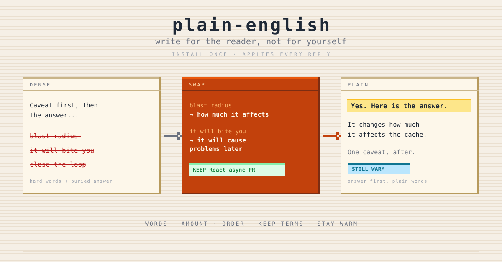

<p align="center">
  
</p>

# plain-english

Make the agent's replies readable for someone who reads English as a second language. Install once, then forget it.

## Why this exists

Agent replies are long and full of hard words. For a reader whose first language is not English, that costs real time — they stop, re-read, and translate in their head.

Two people reported the same thing independently, one of them using no custom rules at all. So this is the model's default writing style, not something a harness caused.

A hand-written rule had already been tried and had failed. Two reasons were found:

- **It had escape clauses.** *"Where a simpler word works just as well"* and *"if an uncommon word is genuinely the best fit"*. Both let the agent decide in its own favour, and it always decided the hard word was the best fit.
- **It only covered words.** It said nothing about how much to write, or what order to write it in.

Short text full of hard words is still hard to read. Long text in easy words is still too much. Both have to be fixed, and they need different rules.

## What it does

- **Installs a rule block** into `~/.claude/CLAUDE.md`, the file Claude Code re-sends as input on every turn. That is what makes the rules apply to every later reply.
- **Carries three rule groups** — words, amount, and order — with no escape clause anywhere.
- **Ships a word-to-word swap list** built from real failures, not from guesses. Fifteen pairs: *blast radius → how much it affects*, *close the loop → finish this*, *it will bite you → it will cause problems later*.
- **Protects technical terms.** React, async, migration, cache, PR stay exactly as they are.
- **Rewrites a passage on demand** when you hand it dense text.
- **Checks its own output by machine.** `scripts/check-swaps.py` reads the swap table straight from the rule block and scans a passage for banned terms, so the check and the rules cannot drift apart. Run it on anything: `python3 skills/plain-english/scripts/check-swaps.py -`.
- **Updates a copy that is already installed.** The block carries a version, so improving the skill can reach a file you installed months ago.

## What it doesn't do

- It does not promise the rules are followed. It puts them in context; it cannot measure attention.
- It does not translate. English only.
- It does not teach English. No lesson plans, no grammar drills, no test prep.
- It does not make text terse. Warm and clear, not short and cold.
- It does not touch anything in your `CLAUDE.md` except its own delimited block, and never without an explicit yes.

## When to use it

- Replies are too long, or too full of hard words, and you want that fixed for good.
- English is not your first language, or not your reader's.
- You want to hand a dense paragraph over and get a plain one back.
- You already wrote plain-language rules by hand and they stopped working.

## When not to use it

| You want | Use instead |
|---|---|
| A message written in your voice, sent under your name | [`ghostwriter`](../ghostwriter/README.md) |
| What one word means in its sentence | [`define`](../define/README.md) |
| Translation files, locale data, cultural rewriting | [`i18n`](../i18n/README.md) |
| To tune how the agent works with you overall | [`whoami`](../whoami/README.md) |

## How it works

```
/plain-english          → read your ~/.claude/CLAUDE.md
                        → find an existing block, or a hand-written section
                        → show the exact change
                        → wait for an explicit yes
                        → write the block, touch nothing else

/plain-english status   → installed? which version? hand-written section too?
/plain-english update   → compare versions, show the difference, offer to update
/plain-english <text>   → rewrite that text, return only the result
```

The rule block itself is the whole product. It lives in [`references/rule-block.md`](references/rule-block.md) as the single source, and the installer copies it without editing.

## Design choices worth knowing

**The skill is not the enforcer.** A skill loads when something triggers it. "Write plainly" has no trigger — it applies to every reply, including the ones where nobody mentions writing. So the skill installs the rules somewhere that is always loaded, and then gets out of the way. The same shape [`kerby`](https://github.com/sorawit-w/kerby) uses.

**No escape clause, anywhere.** *"When a common word exists, use it. There is no exception."* An escape clause in a style rule is the same as no rule. This is the single change most responsible for the rules working at all.

**The list is the rule, not an illustration.** "Use simple words" was tried and failed. A closed list of swaps is something the agent can scan for. A principle is something it can agree with and then ignore. One line stops the opposite failure: *the list is examples, not the whole rule.*

**The check reads the output, not the intent.** The block ends with: read the words you actually wrote, not the ones you meant to write. This is borrowed from [`ghostwriter`](../ghostwriter/README.md), which solved the same problem — an agent will note that it complied and then ship text that did not.

**Warmth is a rule, not a hope.** A swap list with no warmth rule makes cold, clipped text. The reader trades one problem for another. So the rule names the fix: swap the hard word, keep the sentence.

**Domain nouns stay, borrowed pictures go.** This is the test that keeps the skill useful for developers. If the word is in the tool's own documentation, keep it. If it is a picture taken from another field, swap it. "Blast radius" is not a React API.

**`~/.claude/CLAUDE.md`, not a hook.** The global memory file is re-sent as input on every turn and survives a session being summarized. It also avoids the Windows problem where a hook calling a `.sh` script opens an "Open file with" dialog. A `SessionStart` hook would sit in the same place and be less durable, so it is not offered.

## Install

```
/plugin marketplace add sorawit-w/agent-skills
/plugin install agent-skills@sorawit-w
```

Or with `npx`:

```
npx skills add sorawit-w/agent-skills
```

Then, once:

```
/plain-english
```

## Cross-skill integration

| Skill | Relationship |
|---|---|
| [`ghostwriter`](../ghostwriter/README.md) | Nearest neighbour. `ghostwriter` writes what **you** send to other people; `plain-english` governs what the **agent** says to you. The two can be installed together with no conflict. |
| [`whoami`](../whoami/README.md) | Shares the install pattern — a delimited block in `~/.claude/CLAUDE.md`, shown before writing, replaced in place. Both blocks can live in the same file. |
| [`define`](../define/README.md) | Complementary. `define` explains one hard word when you meet it; `plain-english` stops the agent from using it. |
| [`i18n`](../i18n/README.md) | Different layer. `i18n` handles other languages; this one handles English readability. |

## Status and scope

**Tier:** `draft` — it produces text and edits one config file, always after an explicit yes. It never sends anything.

**Supported:** install, update, status, uninstall, and rewriting a passage.

**Not supported yet:** a `UserPromptSubmit` hook that repeats the short rules mid-session. That only gets built if replies are measured getting denser late in a long session. Until that is measured, offering it would be a guess.

## Contributions

Not accepting external contributions right now.

## License

MIT.
